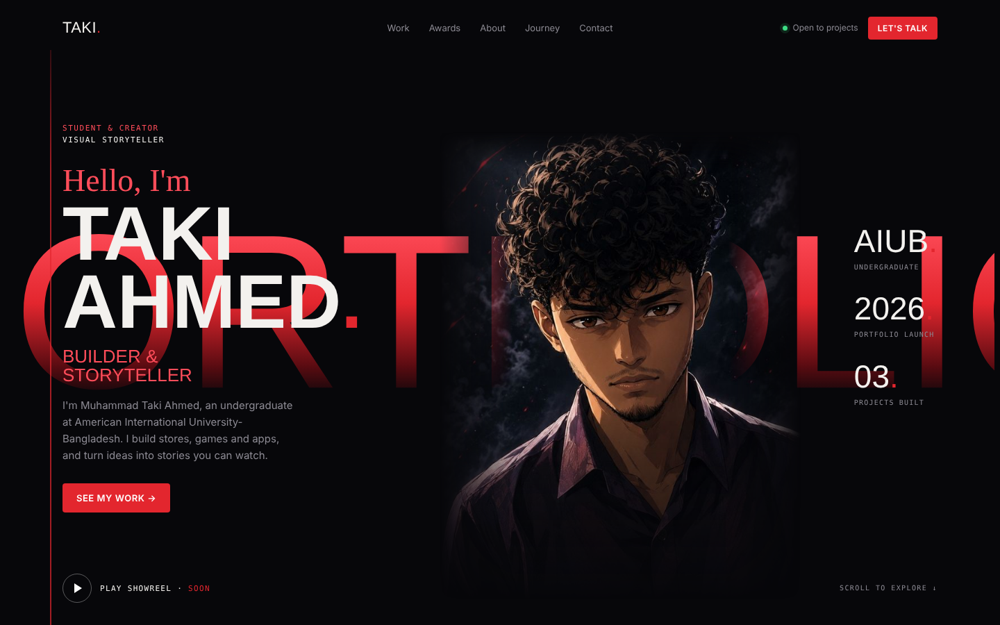

<p align="center">
  
</p>

<h1 align="center">TAKI<span>.</span> — Portfolio</h1>

<p align="center">
  A cinematic one-page portfolio in black and signal red — and the page builds itself.<br>
  A swarm of Figma-style AI agent cursors selects, types and places every layer live, then circles the reel.
</p>

---

## ✦ Highlights

- **Self-building intro** — 18 multiplayer-style cursors draw selection boxes, type text, drop image placeholders and duplicate-drag repeated items, with rulers and a live HUD (pause tour, 1×/2×/4× speed, skip, replay).
- **Cinematic hero** — giant gradient `PORTFOLIO` wordmark, masked portrait with parallax, Ken Burns drift, light sweep and rising sparks.
- **Sections** — Selected work (filterable carousel) · Recognition · From raw to real (before/after slider) · Behind the frames · Journey timeline · Contact.
- **Zero build step** — one `index.html`, plain CSS and vanilla JS. No frameworks, no dependencies.
- **Accessible by default** — respects `prefers-reduced-motion` (skips the build and shows the finished page), keyboard focus styles, responsive down to 360 px.

## ✦ Projects featured

| Project | Type | Status |
|---|---|---|
| [Nyxeris Store](https://nyxeris.store) | E-commerce website | Live |
| Last Charge | Game | In progress |
| CheckFirst | App | In progress |
| Kai · Episode 01 | AI drama series | Coming soon |

## ✦ Run it locally

```bash
git clone https://github.com/takiahmed24/portfolio.git
cd portfolio
# open index.html in a browser, or serve it:
python -m http.server 8000
```

## ✦ Structure

```
portfolio/
├── index.html        # the whole site: markup, styles, build animation
└── assets/
    ├── portrait.jpg  # hero portrait
    └── preview.png   # README preview
```

## ✦ Tech

HTML5 · CSS3 (grid, masks, `color-mix`, clip-path animations) · Vanilla JavaScript (Web Animations API) · Google Fonts: Anton, Archivo, DM Mono, Caveat

---

<p align="center">© 2026 Muhammad Taki Ahmed · Made frame by frame</p>
